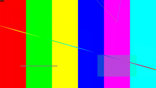

# Windows D3D11 截图与 4K 播放验证（2026-11-16）

本次在检查 [#93](https://github.com/AimesSoft/liberika/issues/93) 的实际播放验收时，确认
D3D11 后端没有实现 `capture_current_frame`：旧 DLL 在已经渲染真实视频后仍返回空截图。
独立工作区以 `f5deb2a` 为基线，仅加入本次截图实现和测试，不包含 PR #214 的修复。
测试的源码、DLL 与环境哈希分别见 [backend manifest](backend/manifest.json) 和
[runtime manifest](runtime/manifest.json)。

## 实现范围

- 使用独立 RGBA8 render target 和 staging texture，按实际 RowPitch 逐行读回。
  不需要窗口 surface，也不修改已发布的 Flutter 纹理或实时输出配置。
- 视频和字幕默认合成；`capture_frame_rgba_with_danmaku` 额外包含当前代际、
  当前请求尺寸的弹幕。HDR/P010/PQ 使用原始颜色元数据重新建立 SDR 色调映射。
- 打包透明视频输出非预乘 alpha（straight RGBA），避免 PNG 编码后半透明颜色变暗。
- GPU 读回有等待上限；截图和后续显示绘制都登记最后一次 GPU 读取的 fence。
  分配失败、绘制失败、Present 失败和超时不会让采样中的解码帧提前归池。

截图使用普通视频缩放，**不应用 ArtCNN/FSR/VSR 超分增强**，不承诺与开启超分的显示画面
逐像素相同。异常销毁若等待再次超时、设备仍有效，会保留 AVFrame 及其关联的解码池/GPU
资源直到进程退出，并记录警告。这是防止不安全归池的异常兜底，不是正常截图的资源回收方式。

## 后端像素验证

| 环境 | 结果 | 范围 |
|---|---|---|
| Microsoft WARP，D3D11 全套 | 34 passed、1 ignored | 新截图用例与既有导入、显示和弹幕测试；忽略项是旧的手动图片输出实验 |
| Intel UHD Graphics 770，硬件 D3D11 | 6 passed | 实际 shader 像素、RGBA 顺序、RowPitch、黑边、无帧/尺寸校验、字幕与可选弹幕、HDR→SDR、透明度、显示状态保持及 fence 退休 |

原始输出：[WARP](backend/d3d11-warp.log)、[Intel 硬件](backend/capture-hardware.log)、
[DLL 构建](backend/capi-capture-build.log) 和 [Windows Clippy](backend/windows-clippy.log)。
Clippy 完成，退出码 0，并保留了风格建议的原始输出。硬件名称来自实际 D3D11 device 的 DXGI adapter，
不是只列机器上已安装的显卡。

## 真实 4K 插件验收

使用 Windows 11 已登录的桌面 Session 2、NVIDIA RTX 5060 Ti、D3D11VA 硬解，播放
3840×2160、10-bit、24 fps、3 秒的**无音轨合成测试图**。执行真实插件 `PlayerHost`、
owner worker、当前源码 C API DLL、Win32 HWND 与 DirectComposition。
Flutter registrar 和平台结果投递使用原生测试 harness，不是完整 Flutter engine UI。

最终严格运行要求：

1. 打开媒体后，视频帧数和播放位置实际推进；native presenter 始终在 owner 线程调用。
2. 同一播放实例生成 320×180 与 **3840×2160** 两张真实 PNG，空截图直接判失败。
   4K RGBA 读回为 **33,177,600 字节**；PNG 解码及颜色统计见 runtime 记录。
3. 暂停实测保持 716 ms，位置漂移为 0；seek/resume 后位置继续推进。
4. Flutter texture resize 至 640×360，detach/reattach 后继续呈现。
5. 实际 HWND underlay 和 Composition 播放、resize、重挂及销毁成功；检查非均匀像素。
6. 等待 owner 结束、释放关联对象，并完成 DLL 卸载；最终 `render_failures=0`。

最终运行通过。相同严格截图 harness 对保留的旧 DLL 在第一张截图处失败，原因为返回空值。

| 最终截图 | PNG 字节数 | 读回与 WIC 编码总耗时 |
|---|---:|---:|
| 320×180 | 23,631 | 5 ms |
| 3840×2160 | 1,966,624 | 292 ms |

这些是该次运行的总耗时，不是纯 GPU 时间或性能基准。4K PNG 解码得到 274,417 种颜色，
alpha 均为 255。下图是缩略预览，[完整原尺寸 PNG](runtime/final-4k-desktop.4k.png) 保留在记录中。



三项 CTest（worker、texture publication、source texture lifecycle）也通过，耗时 1.33 秒；其中截图 stub
只验证 WIC 编码/线程结果投递，**不计入真实截图证据**。

更早的探索没有隐藏：两次 Session 0 运行在 seek 后出现 compositor handoff timeout；
一次 Session 0 无法创建 HWND swapchain；旧 surface harness 还会在短片自然结束后调用
Pause 而失败。它们不是最终验收通过的证据。本次没有修改生产 handoff timeout，也不声称
这些早期 GPU 超时已被修复。逐次变更、退出码及原始日志见 [run history](runtime/run-history.json)。

未覆盖完整 Flutter UI、SMTC 系统按钮、带音轨连续性、物理 HDR 显示质量或 Windows ARM64
实机。这份记录补充 #93 的验收证据，不代表关闭其所有验收项。

## 重跑

先按 [构建说明](../../building.zh.md)准备 MSVC 和原生依赖。PowerShell 中：

```powershell
$env:ERIKA_NATIVE_TARGET = 'x86_64-pc-windows-msvc'
cargo build --locked -p erika_capi --features wgpu
cargo test --locked -p erika --lib renderer::d3d11:: -- --nocapture --test-threads=1

$env:ERIKA_D3D11_CAPTURE_TEST_DRIVER = 'hardware'
cargo test --locked -p erika --lib renderer::d3d11::capture::tests -- --nocapture --test-threads=1
Remove-Item Env:ERIKA_D3D11_CAPTURE_TEST_DRIVER
```

按 [Windows native tests](../../../packages/erika_flutter/windows/tests/CMakeLists.txt) 配置 CMake：

```powershell
cmake -S packages/erika_flutter/windows/tests -B target/windows-native-check -A x64 `
  -DFLUTTER_ENGINE_DIR="$env:FLUTTER_ROOT/bin/cache/artifacts/engine/windows-x64" `
  -DERIKA_SOURCE_DLL="$PWD/target/debug/erika_capi.dll"
cmake --build target/windows-native-check --config Release
ctest --test-dir target/windows-native-check -C Release --output-on-failure

# 在已登录桌面执行；SSH Session 0 不足以验收 HWND / Composition。
$env:ERIKA_FLUTTER_FRAME_TRACE = '1'
& target/windows-native-check/Release/player_lifecycle_test.exe `
  "$PWD/target/debug/erika_capi.dll" --surface-clip 'C:/path/to/synthetic-4k-hevc.mp4'
```

测试入口是 [`player_lifecycle_test.cpp`](../../../packages/erika_flutter/windows/tests/player_lifecycle_test.cpp)。
素材探测信息和 SHA-256 在 `runtime/fixture-probe.json` 与 manifest 中；媒体和 DLL 未放入仓库。
